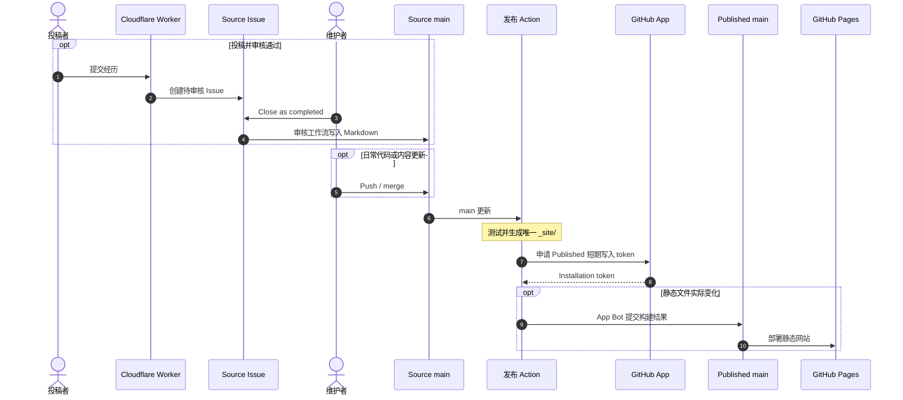

# UEM-Feiyue-Site-Source

由同学共同维护的应急管理大学考研、留学、就业和考公考编经历分享站。本仓库是唯一的源码与构建入口；生成的静态文件发布到 [UEM-Feiyue.github.io](https://github.com/UEM-Feiyue/UEM-Feiyue.github.io)，由 [GitHub Pages](https://uem-feiyue.github.io/) 托管。

> [!WARNING]
> 投稿会成为公开的 GitHub Issue，包括填写的可选联系方式。提交前请确认内容适合公开；审核通过后才会收录到网站。

## 网站功能

- **经历分享**：按考研、留学、就业、考公考编四个方向阅读文章，并按届次筛选。
- **站内搜索**：使用构建时生成的 Pagefind 索引搜索文章正文。
- **社区投稿**：Cloudflare Worker 校验投稿并创建 Source Issue；维护者以 **Close as completed** 审核后入库。
- **阅读体验**：支持浅色、深色与系统主题、移动端导航、文章目录和减少动态效果设置。

网站采用原创「应急蓝」视觉设计；所用蓝色不是经校方确认的标准色值。演示文章会明确标记，不代表真实投稿。

## 项目结构

```text
UEM-Feiyue-Site-Source/
├── .github/workflows/  # PR 验证、审核入库和跨仓库发布
├── assets/             # 样式、脚本和图片
├── content/            # 文章与社区投稿 Markdown
├── data/schema.json    # 投稿分类和字段的唯一规则
├── scripts/            # 静态构建、索引和审核入库
├── tests/              # 单元、Worker 和浏览器回归测试
├── worker/             # Cloudflare 投稿接口
├── index.html          # 首页及共享页面结构
├── submit.html         # 投稿页面
├── community.html      # 社区共建页面
├── preview.py          # 本地预览与构建入口
└── PUBLISHED_README.md # Published README 的唯一来源
```

## 技术栈

- **HTML / CSS / JavaScript**：原生页面、交互与主题
- **Python / Markdown**：文章生成、内容校验与审核入库
- **Pagefind**：构建时生成静态全文索引
- **Cloudflare Worker + Turnstile**：校验投稿并创建 Source Issue
- **GitHub Actions + GitHub App**：测试、生成网站并用短期 token 发布到 Published

## 本地开发

需要 Python 3.10 或更新版本。在 Source 根目录运行以下命令，启动本地预览：

```sh
python preview.py
```

打开 <http://127.0.0.1:8765/>；修改源码后刷新页面即可查看结果，结束时按 Ctrl+C。Windows 可使用 `py -3` 替代 `python`。首次运行会按需安装项目依赖到 `.venv/`。只构建、运行测试或检查浏览器时，按 [PREVIEW.md](PREVIEW.md) 中对应步骤操作。

## 构建与发布

**Source**（本仓库）维护页面、文章、投稿审核和唯一的生产构建。**Published**（`UEM-Feiyue/UEM-Feiyue.github.io`）只保存构建结果；GitHub Pages 直接部署其 `main`，不在发布仓库重新构建。Published 的 `README.md` 由 [PUBLISHED_README.md](PUBLISHED_README.md) 生成。



发布工作流也支持手动触发。静态文件没有变化时不会产生 Published 提交；`build-info.json` 记录 Source 提交与构建运行。未来如使用 Vercel，应连接 Published 的 `main` 并直接部署同一份静态文件。

## 文档与参与

- [AGENTS.md](AGENTS.md)：工程原则与修改边界
- [PREVIEW.md](PREVIEW.md)：开发、测试和发布操作
- [content/README.md](content/README.md)：文章格式与内容维护
- [worker/README.md](worker/README.md)：Worker 部署与投稿安全配置
- [PUBLISHED_README.md](PUBLISHED_README.md)：Published README 的唯一来源

欢迎通过 [Issues](https://github.com/UEM-Feiyue/UEM-Feiyue-Site-Source/issues) 反馈资料问题，或通过 [Pull Requests](https://github.com/UEM-Feiyue/UEM-Feiyue-Site-Source/pulls) 参与共建。

**Every line of code should justify its existence. Define once. Reuse everywhere.**
